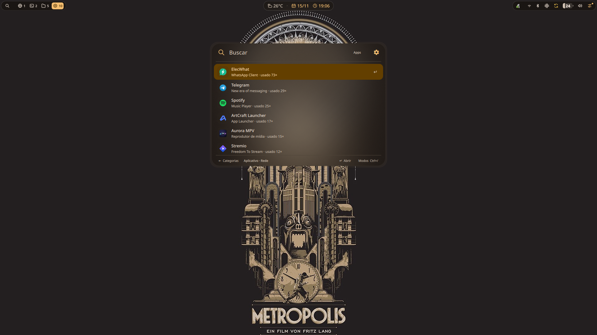

# Lume Shell

Lume is a desktop shell built with Quickshell. It puts your workspaces, apps,
notifications and everyday controls in one place.

Development is focused on Arch Linux with Hyprland. Other Wayland compositors
are supported through shared protocols where available, but some features
still need compositor-specific integration.



## What’s included

The bar shows your workspaces, weather, clock and system status. Click its
controls to adjust audio, connect to a network, check updates or read
notifications.

Spotlight opens apps, finds files and windows, and keeps clipboard history
close at hand. It also handles calculations, emoji and system actions.

Theme Studio lets you choose a palette or use Chameleon to pick colors from
your wallpaper. The shell also includes media controls, night light, power
profiles, and volume and brightness indicators.

## Installation

For Arch Linux, follow the [package instructions](packaging/arch/README.md).
The package installs the shell in `/usr/share/lume-shell` and provides the
`lume-shell` command, user service, and Lume-owned system power integrations.

You’ll need Quickshell, PipeWire, Python, Kitty and the interface fonts.
Individual features use tools such as NetworkManager, `wl-clipboard`,
`brightnessctl` and `upower`. The package recipe lists the dependencies.

Compositor setup is covered in the [Hyprland](docs/setup/hyprland-install.md),
[labwc](docs/setup/labwc-install.md) and [Wayland](docs/setup/wayland-install.md) guides.

## Running from source

```sh
git clone https://github.com/emanuelserpa/lume-shell.git
cd lume-shell
quickshell --path .
```

If the installed shell is already running, stop `lume-shell.service` first
so you don’t end up with two instances.

To check a change locally:

```sh
./scripts/validate.sh
```

The [docs](docs/README.md) cover the individual features and how the code is
organized. See [build and validation](docs/deploy-and-validation.md) for more
about the checks, and [CHANGELOG.md](CHANGELOG.md) for version history.

## License

[MIT](LICENSE). Third-party assets and dependencies keep their own licenses.
