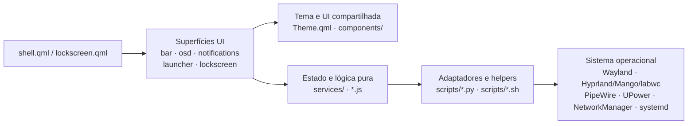

# Arquitetura do Lume

O Lume separa **interface (QML)**, **lógica pura (JS)**, **estado compartilhado (`services/`)** e **integração com o sistema (`scripts/`)**. Para saber em qual arquivo cada módulo mora, consulte [o mapa atual](current-state.md).

## Fluxo entre camadas

## Onde colocar cada coisa

| Camada | Pastas | Responsabilidade | Regra principal |
| --- | --- | --- | --- |
| **Superfícies UI** | `bar/`, `osd/`, `notifications/`, `launcher/`, `lockscreen/` | Apresentação, foco, animações e ações do usuário | Declarar inputs com `required property`; nunca chamar `hyprctl` ou ler segredos/SQLite direto no QML |
| **Componentes e lógica pura** | `components/`, `*.js` | Controles reutilizáveis (`PopupHeader`, `SliderRow`, etc.) e regras sem efeitos colaterais | Usar tokens de `Theme.qml` (zero cores literais); funções puras em JS para testar no `qmltestrunner` |
| **Estado compartilhado** | `services/` | Singletons reativos, fila/cache e coordenação entre telas (`CommandJson`, `CommandAction`) | Só criar singleton quando vários consumidores ou ciclo global exigirem; estado de um popup fica local |
| **Sistema e compositores** | `scripts/`, `system/` | Consultas, escrita segura em `$XDG_STATE_HOME`/`$XDG_CACHE_HOME` e despacho de compositor | Helpers retornam JSON `{ok, version, data, error}`; comandos externos com timeout e validação estrita |

## Regras práticas de implementação

- **Barra fixa e previsível:** `bar/Bar.qml` lista as ilhas e os módulos explicitamente; não trocar por criação dinâmica.
- **Comunicação explícita:** usar `pragma ComponentBehavior: Bound`, qualificar bindings pelo ID raiz e emitir sinais em vez de depender de contexto implícito do pai.
- **Limites do compositor:** comandos nativos ficam apenas em `scripts/compositor-dispatch.sh`; workspaces/janelas preferem protocolos Wayland compartilhados via `CompositorState` e `WorkspaceModel.js`.
- **Temas centralizados:** valores de paleta ficam apenas em `Theme.qml` e `services/ThemeState.qml`.

## Onde buscar detalhes

- **Onde fica cada recurso:** [current-state.md](current-state.md)
- **Comportamento que não pode quebrar:** [stability-contract.md](stability-contract.md)
- **Regras visuais e tokens:** [design-guidelines.md](design-guidelines.md)
- **Guias de cada domínio:** [docs/README.md](README.md)
- **Testes e empacotamento:** [deploy-and-validation.md](deploy-and-validation.md)
